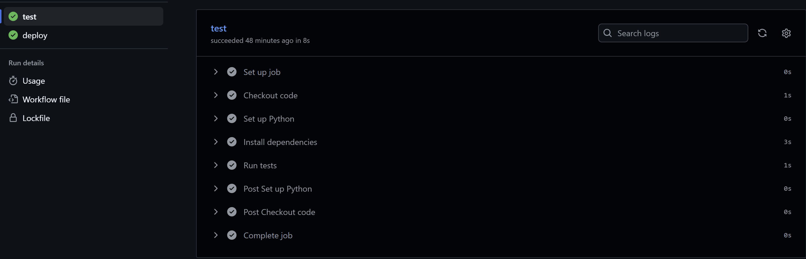
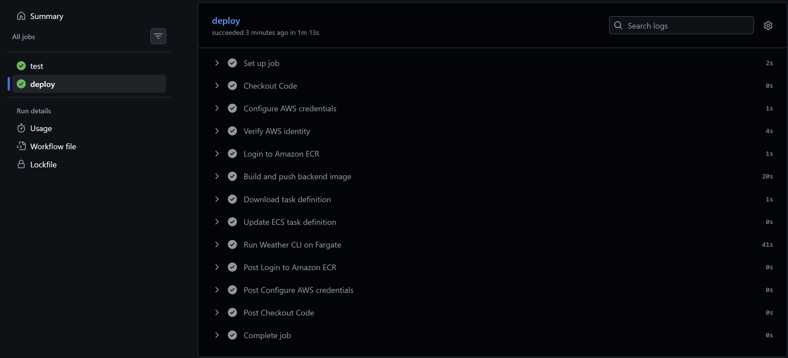

# Weather App CI/CD Pipeline on AWS

_Automated testing, Docker image delivery, and one-off execution of a Python weather CLI using GitHub Actions and AWS container services._

---

## 📌 Table of Contents

- <a href="#overview">Overview</a>
- <a href="#project-goals">Project Goals</a>
- <a href="#architecture-and-workflow">Architecture and Workflow</a>
- <a href="#tools-and-technologies">Tools and Technologies</a>
- <a href="#project-structure">Project Structure</a>
- <a href="#pipeline-execution">Pipeline Execution</a>
- <a href="#how-the-pipeline-works">How the Pipeline Works</a>
- <a href="#run-locally">Run Locally</a>
- <a href="#aws-configuration">AWS Configuration</a>
- <a href="#security-and-cost-notes">Security and Cost Notes</a>
- <a href="#author">Author</a>

---

<h2><a class="anchor" id="overview"></a>Overview</h2>

This project automates the CI/CD workflow for a Python command-line weather application that retrieves weather data from the **OpenWeatherMap API** using an API key. When code is pushed to the `main` branch, GitHub Actions runs the automated tests, builds a Docker image, pushes the image to Amazon Elastic Container Registry (ECR), updates the Amazon ECS task definition, and launches the application as a one-off AWS Fargate task.

Because the application is a CLI that prompts for a city, the workflow supplies a city (`Hyderabad`) through standard input rather than expecting a person to type into a non-interactive container.

> **Execution model:** This project runs a one-off ECS task, not a continuously running web service. A task stopping after its command completes is expected; the application should still exit successfully for the run to be considered healthy.

---

<h2><a class="anchor" id="project-goals"></a>Project Goals</h2>

- Run Python tests automatically on pushes and pull requests.
- Package the application and its dependencies into a Docker image.
- Publish versioned images to a private Amazon ECR repository.
- Update the ECS task definition to use the newly built image.
- Run the CLI on ECS Fargate with non-interactive input supplied by the workflow.
- Retrieve weather data from the OpenWeatherMap API using an API key supplied securely at runtime.
- Keep deployment steps repeatable and visible through GitHub Actions logs.

---

<h2><a class="anchor" id="Architecture-and-Workflow"></a>Architecture and Workflow</h2>


1. A developer pushes code to GitHub.
2. GitHub Actions checks out the repository and installs test dependencies.
3. `pytest` runs the automated tests.
4. The workflow builds a Docker image and tags it with the Git commit SHA.
5. The image is pushed to Amazon ECR.
6. The workflow renders a new ECS task definition revision with the new image.
7. An ECS Fargate task runs the Weather CLI with `Hyderabad` supplied as input.
8. The CLI uses the OpenWeatherMap API and its API key to request weather data for the city.
9. Task output and errors can be inspected through the configured container logging destination, if logging is enabled in the task definition.

**Note:** The architecture image is a conceptual overview. The sample weather values shown in the terminal are illustrative and should not be treated as actual output from a recorded run. The AWS region used by the workflow is `eu-north-1` (Europe/Stockholm); make sure any diagram label matches your configuration.

---

<h2><a class="anchor" id="Tools-and-Technologies"></a>Tools and Technologies</h2>

- Python (Weather CLI and automated tests)
- OpenWeatherMap API (Weather data source; API key authentication)
- pytest (Automated testing)
- Docker (Containerization)
- Git and GitHub (Version control and source code hosting)
- GitHub Actions (CI/CD automation)
- AWS IAM (Access and permissions)
- Amazon ECR (Docker image registry)
- Amazon ECS and AWS Fargate (Container task execution)
- Amazon CloudWatch Logs (Container logging)
---

<h2><a class="anchor" id="project-structure"></a>Project Structure</h2>

```text
weather-app/
├── .github/
│   └── workflows/
│       └── aws-deploy.yaml      # CI/CD workflow
├── src/
│   └── main.py                  # Python weather CLI
├── tests/
│   └── test_weatherapp.py       # Automated tests
├── .dockerignore                # Excludes unnecessary files from Docker build context
├── .gitignore                   # Excludes local/generated files from Git                 
├── Dockerfile                   # Container image instructions
├── requirements-dev.txt         # Python dependencies used by the project/tests
└── README.md
```

> Keep the tree aligned with the files actually committed to your repository. If your workflow has a different filename, update the path above.

---

<h2><a class="anchor" id="Pipeline-Excution"></a>Pipeline Excution</h2>


### 1. Automated test job

The screenshot below shows the `test` job completing successfully, including Python setup, dependency installation, and the test step.



### 2. Deployment job

The screenshot below shows the deployment job's steps completing successfully, including AWS credential configuration, identity verification, ECR login, image build/push, task-definition update, and the Fargate task action.



> A successful GitHub Actions job confirms that the workflow action completed successfully. For end-to-end validation, also check the latest ECS task's container exit code and verify the actual application output. The screenshots above do not by themselves prove that weather data was returned successfully.

---

<h2><a class="anchor" id="Pipeline-Workflow"></a>Pipeline Workflow</h2>


### Continuous Integration (CI)

- Triggers on pushes and pull requests targeting `main`.
- Checks out the repository.
- Sets up Python.
- Installs dependencies from `requirements-dev.txt`.
- Runs tests using `python -m pytest -v`.

### Continuous Delivery / Execution (CD)

On a push to `main`, after tests pass, the deployment job:

- Configures AWS credentials from GitHub Actions secrets.
- Verifies the AWS identity with AWS STS.
- Authenticates Docker to Amazon ECR.
- Builds and pushes an image tagged with the Git commit SHA.
- Retrieves the current ECS task definition and renders it with the new image.
- Starts a one-off Fargate task and waits for it to stop.

---

<h2><a class="anchor" id="Run-Locally"></a>Run Locally</h2>

Clone the repository and move into the project directory:

```bash
git clone <YOUR-GITHUB-REPOSITORY-URL>
cd weather-app
```

Create and activate a virtual environment (optional but recommended):

```bash
python -m venv .venv
```

On Windows PowerShell:

```powershell
.\.venv\Scripts\Activate.ps1
```

On Linux/macOS:

```bash
source .venv/bin/activate
```

Install dependencies and run tests:

```bash
python -m pip install -r requirements-dev.txt
python -m pytest -v
```

Run the CLI:

```bash
python -m src.main
```

When prompted, enter a city name. The application fetches weather data from the OpenWeatherMap API and therefore needs a valid OpenWeatherMap API key. Configure the key using the environment variable name expected by your application and document that variable in `.env.example` without including the real key. Never commit a populated `.env` file or the API key.

---

<h2><a class="anchor" id="AWS-configuration"></a>AWS Configuration</h2>

Before using the workflow, configure the following in AWS and GitHub:

- An Amazon ECR repository named `weather-app` in `eu-north-1`.
- An ECS cluster named `weather-app-cluster`.
- An ECS task definition family matching the name in the workflow and a container named `weather-app`.
- A Fargate-compatible task definition using `awsvpc` network mode.
- A subnet and security group that allow the task to reach the OpenWeatherMap API over HTTPS. Public IP assignment is enabled in the current workflow; ensure the subnet routing supports internet access if the app needs it.
- A secure runtime configuration for the OpenWeatherMap API key. Supply it to the container through an appropriate secret mechanism (for example, AWS Secrets Manager or Systems Manager Parameter Store) or a protected GitHub Actions secret if your workflow explicitly passes it through. Do not bake the key into the Docker image or commit it to the repository.
- GitHub Actions secrets `AWS_ACCESS_KEY_ID` and `AWS_SECRET_ACCESS_KEY` for the IAM identity used by the workflow.
- GitHub Actions repository variables `ECS_SUBNETS` and `ECS_SECURITY_GROUPS` containing the correct subnet and security group IDs expected by the workflow.
- IAM permissions scoped as narrowly as practical for ECR image publishing and ECS task execution/registration.

Never commit AWS credentials, API keys, or populated `.env` files to GitHub.

---

<h2><a class="anchor" id="Security-and-cost-notes"></a>Security and Cost Notes</h2>

- Prefer GitHub OIDC with an IAM role for longer-term use; this version uses access-key secrets.
- Store the OpenWeatherMap API key securely and inject it into the container at runtime; never hard-code it in Python files, Dockerfile, screenshots, or README examples.
- Use least-privilege IAM policies and rotate access keys if they may have been exposed.
- ECS Fargate, ECR storage, public IPv4 usage, CloudWatch Logs, and related networking resources may incur charges depending on configuration and usage. Review AWS billing and remove resources you no longer need.
- A one-off CLI task is different from a long-running ECS service; do not expect the task to remain in `RUNNING` state after the command exits.

---

<h2><a class="anchor" id="Author"></a>Author</h2>

- **Name:** `<RAKESH BABU CHEEPI>`
- **LinkedIn:** `<www.linkedin.com/in/rakesh-cheepi>`
- **GitHub:** `<Rakeshgit369>`
